<p align="center">
  
</p>

<p align="center">
  <a href="https://github.com/lucasyemz/iptvkz/releases/latest"></a>
  <a href="https://github.com/lucasyemz/iptvkz/actions/workflows/build.yml"></a>
  <a href="https://github.com/lucasyemz/iptvkz/releases"></a>
  <a href="LICENSE"></a>
  <br />
  
  
  
  
  
</p>

<p align="center"><b>Player IPTV leve para o computador, a TV e o celular.</b><br />
Use suas listas M3U e Xtream Codes com TV ao vivo, guia de programação, filmes, séries, áudio e legendas, tudo em português.</p>

<p align="center">
  <a href="#instalar">Instalar</a> ·
  <a href="#recursos">Recursos</a> ·
  <a href="#capturas-de-tela">Capturas</a> ·
  <a href="#atualizações">Atualizações</a> ·
  <a href="#rodar-pelo-código">Rodar pelo código</a>
</p>

---

> [!IMPORTANT]
> O IPTVKZ é **só um player**. Ele não vem com nenhuma lista, canal ou conteúdo: você usa as listas que você mesmo cadastrar e é o único responsável pelo que adiciona e assiste. Use apenas conteúdo que você tem direito de assistir. Ao usar o app você concorda com os **[Termos de Uso](src/web/termos.txt)**.

## Capturas de tela

As telas abaixo usam uma lista de demonstração com canais, filmes e séries fictícios.

### Computador

<table>
  <tr>
    <td width="50%">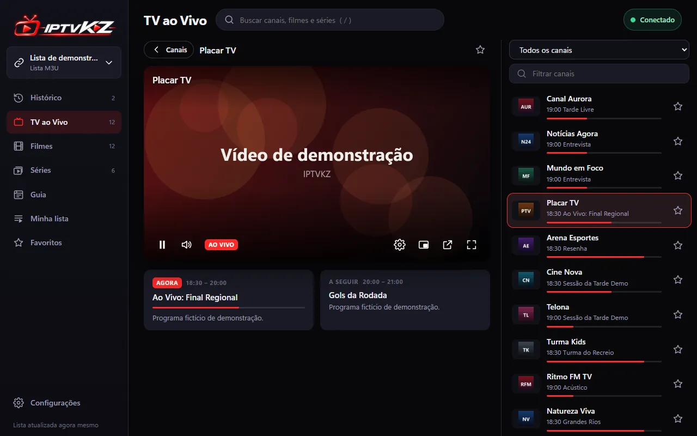<p align="center"><sub>TV ao vivo: player, agora/a seguir e lista para zapear</sub></p></td>
    <td width="50%">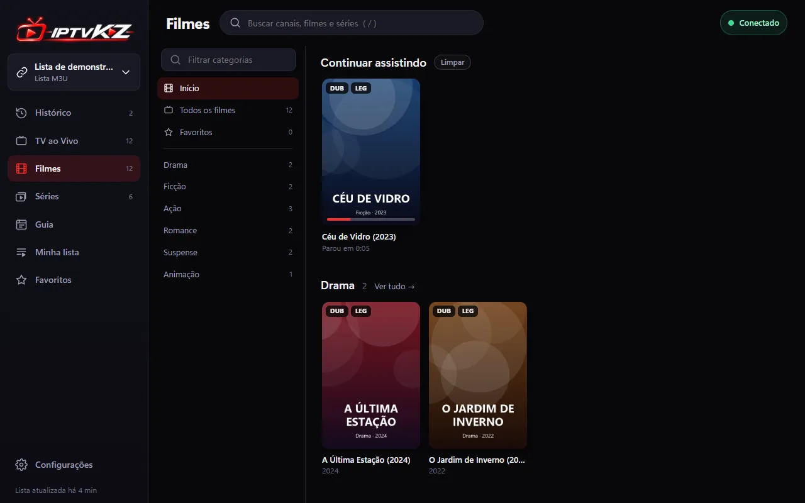<p align="center"><sub>Filmes: continuar assistindo e prateleiras</sub></p></td>
  </tr>
  <tr>
    <td>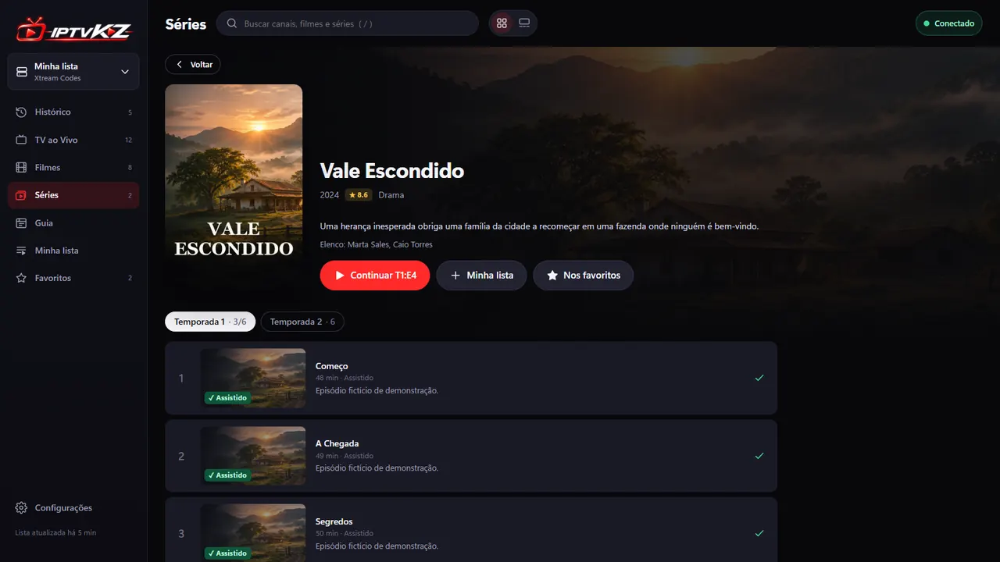<p align="center"><sub>Séries: temporadas, episódios e próximo episódio</sub></p></td>
    <td>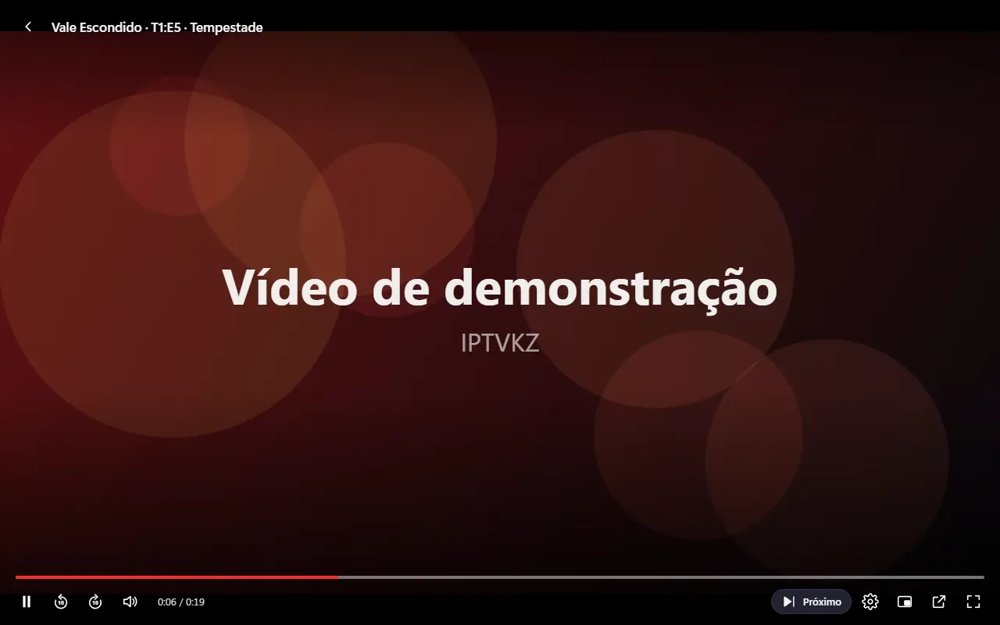<p align="center"><sub>Player com áudio, legendas, PiP e VLC</sub></p></td>
  </tr>
  <tr>
    <td>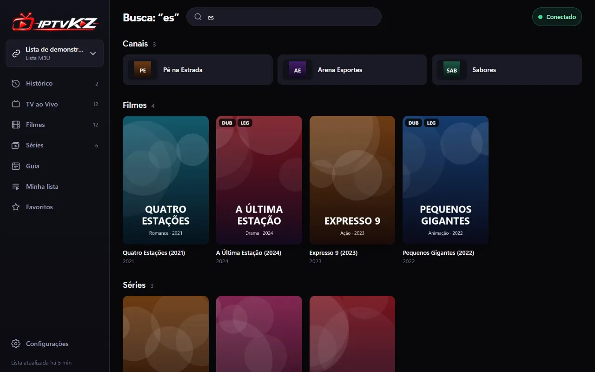<p align="center"><sub>Busca em canais, filmes e séries</sub></p></td>
    <td>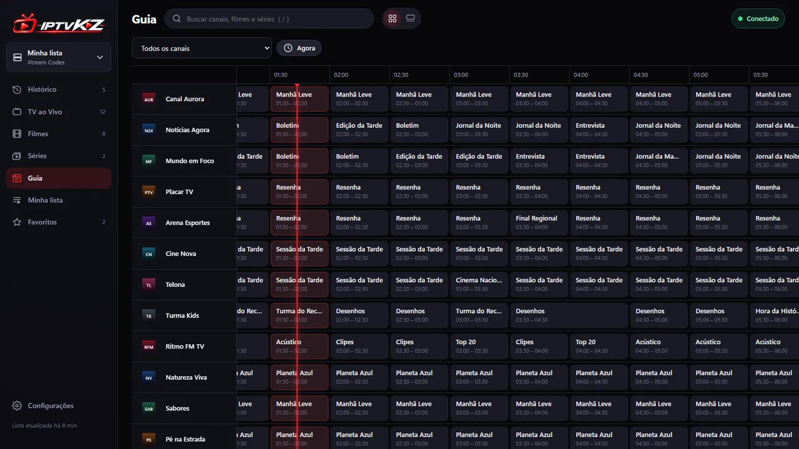<p align="center"><sub>Guia de programação (EPG)</sub></p></td>
  </tr>
  <tr>
    <td>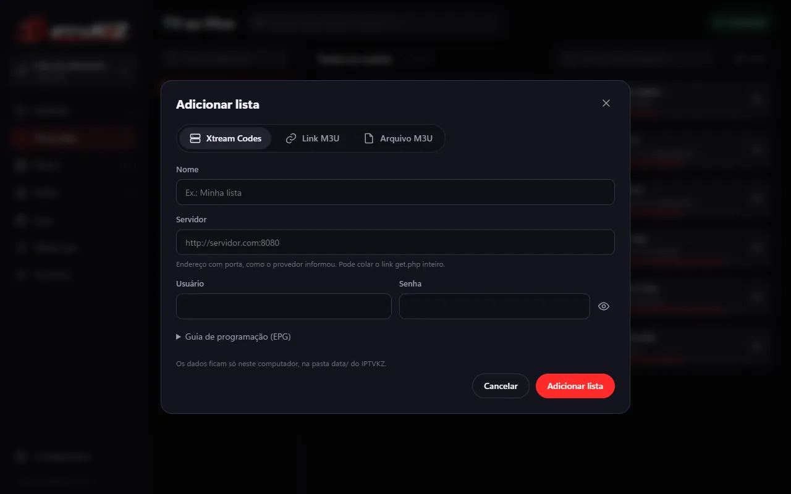<p align="center"><sub>Adicionar lista: Xtream, link ou arquivo M3U</sub></p></td>
    <td>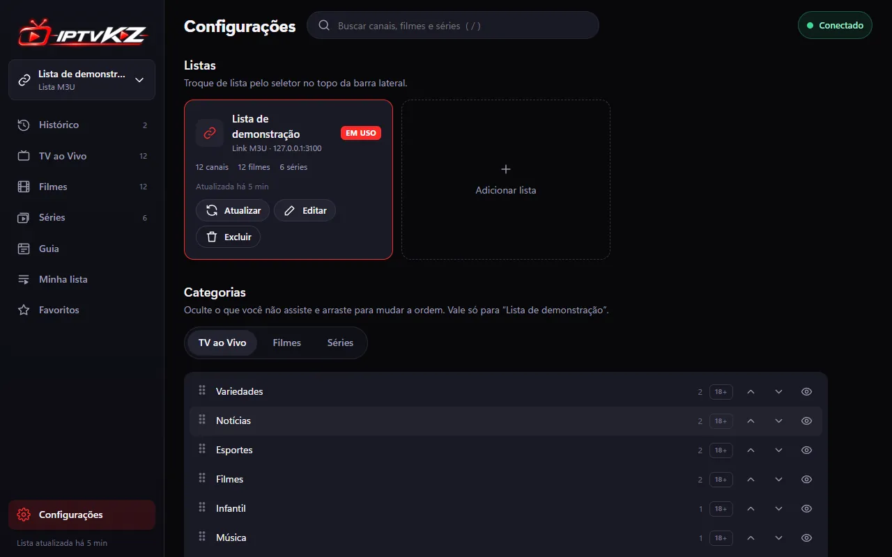<p align="center"><sub>Configurações: listas e categorias</sub></p></td>
  </tr>
</table>

### Modo TV

Letras maiores e navegação pelas setas, OK e Voltar do controle remoto.

<table>
  <tr>
    <td width="50%">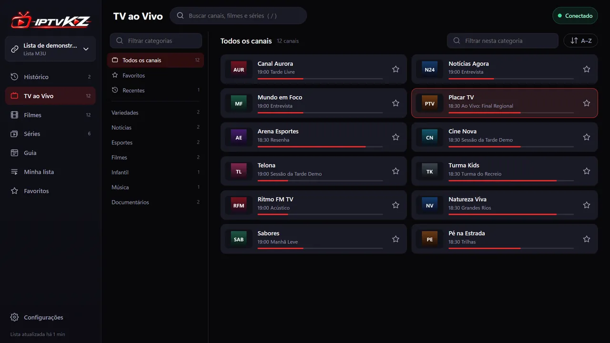<p align="center"><sub>Canais com o foco do controle</sub></p></td>
    <td width="50%">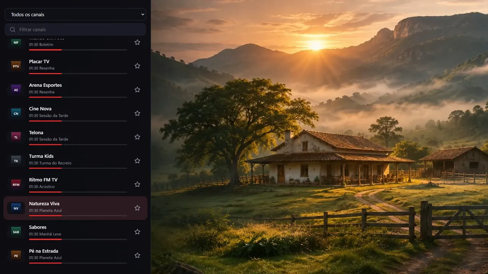<p align="center"><sub>Tela cheia com a lista para zapear (◀)</sub></p></td>
  </tr>
  <tr>
    <td>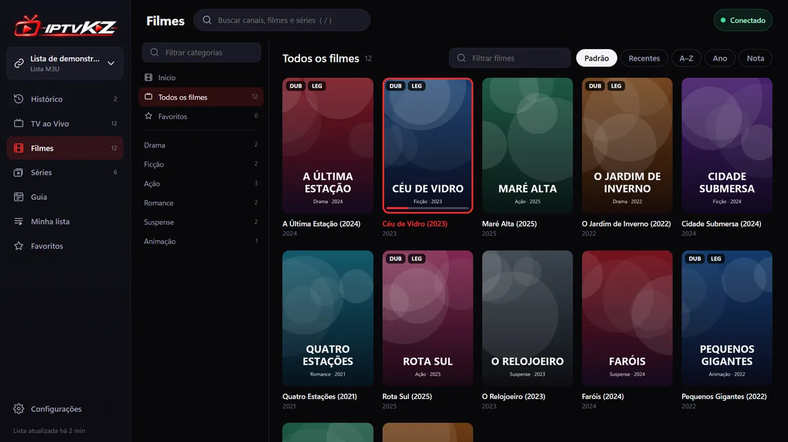<p align="center"><sub>Filmes</sub></p></td>
    <td>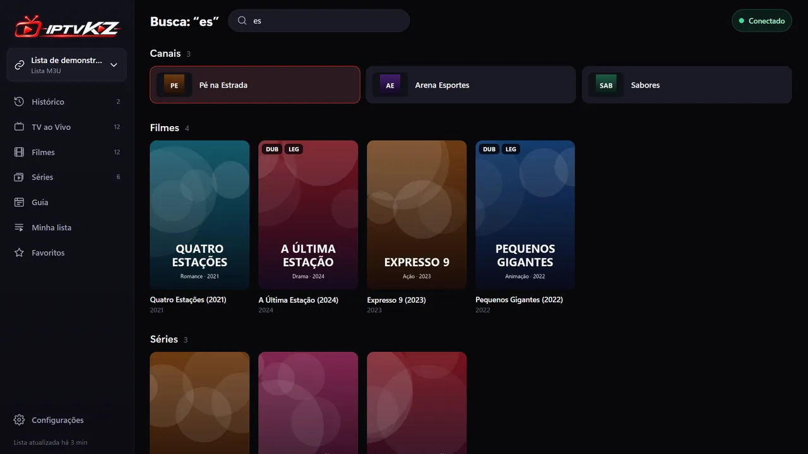<p align="center"><sub>Busca</sub></p></td>
  </tr>
</table>

## Recursos

- **Listas:** link M3U/M3U8, arquivo `.m3u` ou conta **Xtream Codes**. Várias listas com troca rápida, cache e atualização automática a cada 12h.
- **TV ao vivo:** categorias, favoritos, recentes, busca e agora/a seguir do guia. Ao assistir, a lista lateral permite zapear com ↑/↓.
- **Filmes e séries:** prateleiras, “Continuar assistindo”, temporadas e episódios, próximo episódio automático. Versões **Dublado/Legendado** do mesmo título viram um cartão só.
- **Guia (EPG):** XMLTV (inclusive `.gz`) em grade de horários, com ajuste de fuso por lista.
- **Player:** HLS (hls.js), MPEG-TS (mpegts.js) e nativo. Troca de **áudio**, **legendas** (do stream ou arquivo `.srt`/`.vtt`, com atraso, tamanho e fundo), qualidade, picture-in-picture e **“Abrir no VLC”** para formatos que o navegador não toca.
- **Modo TV:** navegação pelo controle remoto, zapping em tela cheia, busca por voz com o teclado do sistema na LG e no Android. Compatível com TVs antigas (webOS 4+).
- **Lista pelo celular:** nos apps da LG e do Android TV, a TV mostra um QR Code e você preenche a lista no celular, pela rede de casa, sem digitar com o controle.
- **Controle dos pais:** PIN de 4 dígitos que esconde canais, filmes e séries adultos (detectados pelo nome ou marcados por você) em todos os aparelhos.
- **Leve:** interface em JavaScript puro, sem framework, e servidor Node sem dependências. Nada de conversão de vídeo no aparelho.

## Instalar

Baixe os arquivos na página de **[Releases](https://github.com/lucasyemz/iptvkz/releases/latest)**.

| Aparelho | Arquivo | Precisa de computador ligado? |
|---|---|---|
| Windows | `IPTVKZ-x.y.z-windows-setup.exe` (instalador) ou `-windows-portable.exe` (sem instalar) | — |
| macOS | `IPTVKZ-x.y.z-mac-arm64.dmg` (Apple Silicon) ou `-mac-x64.dmg` (Intel) | — |
| Linux | `.AppImage` ou `.deb` | — |
| LG webOS | arquivo `.ipk` | Não |
| Android TV e celular Android | `IPTVKZ-android.apk` | Não |
| Qualquer TV ou celular com navegador | nenhum: abre pelo navegador | Sim |

### Computador (Windows, macOS e Linux)

Instale e abra como qualquer app. Os instaladores ainda **não têm assinatura digital**, então o sistema avisa na primeira vez:

- **Windows:** “O Windows protegeu o computador” → *Mais informações* → *Executar assim mesmo*.
- **macOS:** clique com o botão direito no app → *Abrir* → *Abrir*.

### LG webOS

O app da LG é independente: a interface e o servidor rodam dentro da própria TV, sem computador.

1. Na TV, instale o app **Developer Mode** da LG Content Store e ative o modo desenvolvedor (precisa de uma conta LG Developer).
2. No computador, instale as ferramentas da LG (`npm install -g @webos-tools/cli`) e cadastre a TV com `ares-setup-device`.
3. Instale o arquivo baixado:

```bash
ares-install --device minha-tv com.lucasyemz.iptvkz_*.ipk
```

O modo desenvolvedor da LG expira depois de um tempo; renove a sessão pelo app Developer Mode para o IPTVKZ continuar abrindo.

### Android TV

Também independente: o servidor roda dentro da TV.

1. Permita a instalação de apps de fontes desconhecidas no app que vai abrir o APK (por exemplo, um gerenciador de arquivos ou o Downloader).
2. Copie o `IPTVKZ-android.apk` para a TV (pendrive, rede ou download direto) e instale.

O IPTVKZ aparece na tela inicial da TV, com o banner próprio.

### Celular

- **Android:** o mesmo `IPTVKZ-android.apk` instala no celular e abre com a tela deitada.
- **iPhone ou outro aparelho:** use pelo navegador, com o computador como servidor (veja abaixo).

### Pelo navegador de qualquer TV ou celular

Com o app de computador aberto:

1. **Configurações → TV e outros aparelhos → Permitir acesso pela rede de casa**.
2. Se o Windows perguntar, permita o IPTVKZ (ou o Node.js) em **Redes privadas**.
3. No navegador da TV ou do celular, abra o endereço mostrado (ex.: `http://192.168.1.10:8787`).

O computador precisa ficar ligado. Com o acesso pela rede ligado, fechar a janela deixa o IPTVKZ na bandeja do sistema, e a opção **Iniciar com o sistema** abre ele em segundo plano quando o computador liga. Na TV, o modo TV liga sozinho; em outro aparelho, use `?tv=1` no endereço.

## Atualizações

Tudo sai das [Releases](https://github.com/lucasyemz/iptvkz/releases):

- **LG e Android TV:** ao abrir, o app confere a Release mais recente, baixa as mudanças da interface e do servidor (`src/`), confere a assinatura e aplica antes de mostrar a tela inicial. Não precisa reinstalar.
- **App Android novo:** só quando muda a parte nativa (Java). Aí o app oferece baixar o APK novo e o Android pede a confirmação.
- **App da LG novo:** mudanças no próprio IPK pedem instalar o `.ipk` novo com `ares-install`.
- **Computador:** baixe e instale a versão nova da página de Releases.

<details>
<summary>Como publicar uma versão (para quem mantém o projeto)</summary>

1. Envie uma tag `v*` (ex.: `v1.0.4`). O GitHub Actions gera os instaladores, o IPK, o APK e os pacotes de atualização assinados e anexa tudo a um **rascunho** de Release.
2. Publique o rascunho. Só a Release publicada chega aos aparelhos.
3. Se mudou o app Android (Java, C++, permissões), aumente antes `nativeVersion` em `platforms/android/version.properties`.

As chaves de assinatura ficam nos secrets do GitHub (`ANDROID_KEYSTORE_BASE64`, `ANDROID_KEYSTORE_PASSWORD`, `ANDROID_UPDATE_KEY`). Sem a mesma chave, a TV não aceita a atualização.
</details>

## Rodar pelo código

Requisitos: [Node.js](https://nodejs.org) 18 ou mais novo.

```bash
git clone https://github.com/lucasyemz/iptvkz.git
cd iptvkz
npm start
```

Abra http://localhost:8787. Só o servidor não precisa de `npm install`. Suas listas e preferências ficam em `data/`, fora do Git.

| Comando | O que faz | Saída |
|---|---|---|
| `npm start` | sobe o servidor local na porta 8787 | — |
| `npm run desktop` | abre o app de computador (Electron) em modo desenvolvimento | — |
| `npm run build` | gera a versão para TVs antigas (`src/web/js/app.legacy.js`) | `src/web/js/` |
| `npm run vendor` | copia hls.js e mpegts.js para `src/web/vendor/` | `src/web/vendor/` |
| `npm run dist:win` / `dist:mac` / `dist:linux` | gera os instaladores do computador | `dist/desktop/` |
| `npm run ipk` | gera o app da LG | `dist/webos/` |
| `npm run android` | gera o APK (precisa de JDK 17 e Android SDK com NDK) | `dist/android/` |

Rode `npm install` antes dos comandos que usam ferramentas (Electron, esbuild, webOS CLI). Depois de mexer em `src/web/js`, rode `npm run build` para atualizar a versão das TVs antigas.

No GitHub, cada pull request gera os instaladores como artefatos para teste.

### Como o projeto é organizado

```
src/
  server/            servidor local: API, proxy de streams, catálogo (M3U/Xtream), guia (XMLTV), dados
  web/               interface (HTML/CSS/JS sem framework), servida como está
    js/core/         estado, utilidades, ícones, busca
    js/player/       player, prévia, legendas, limite de telas
    js/tv/           modo TV: foco, controle remoto, teclados
    js/views/        telas do app
platforms/
  desktop/           app de computador (Electron)
  webos/             app da TV LG
  android/           app do Android TV
  windows/           atalho do Windows para rodar pelo código
assets/brand/        logos e ícones originais
docs/                especificação e capturas de tela
scripts/             builds e manutenção
dist/<plataforma>/   saída dos builds (fora do Git)
data/                listas e preferências ao rodar pelo código (fora do Git)
```

O servidor local faz proxy dos streams (resolve CORS e links `http`), junta as listas num catálogo único e processa o guia. Ele aceita só o próprio aparelho e, se você ligar, aparelhos da sua rede de casa. As regras de organização estão no [`CLAUDE.md`](CLAUDE.md).

## Termos e licença

- **[Termos de Uso](src/web/termos.txt):** aceitos na primeira vez que o app abre (e no instalador do Windows).
- **Código:** [Licença MIT](LICENSE).
