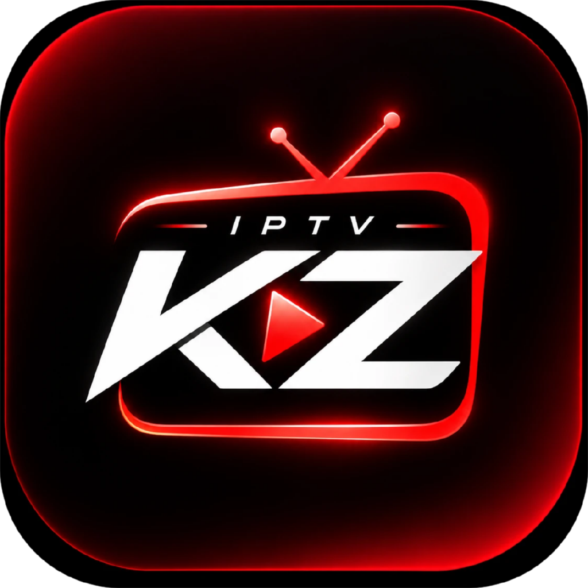

<p align="center">
  
</p>

<h1 align="center">IPTVKZ</h1>

<p align="center">Player IPTV pessoal para o computador e a TV — listas M3U e Xtream Codes, guia de programação, filmes, séries, áudio e legendas.</p>

---

> O IPTVKZ é **só um player**. Ele não vem com nenhuma lista, canal ou conteúdo: você usa as listas que você mesmo cadastrar. Use apenas conteúdo que você tem direito de assistir.

## Recursos

- **Listas:** link M3U/M3U8, arquivo `.m3u` ou conta **Xtream Codes** — várias listas com troca rápida, cache e atualização automática a cada 12h.
- **TV ao Vivo:** categorias, favoritos, recentes, busca, agora/a seguir do guia; ao assistir, lista lateral para zapear (↑/↓).
- **Filmes e Séries:** prateleiras, “Continuar assistindo”, temporadas/episódios, próximo episódio automático. Versões **Dublado/Legendado** do mesmo título viram um cartão só.
- **Guia (EPG):** XMLTV (inclusive `.gz`) em grade de horários, com ajuste de fuso por lista.
- **Player:** HLS (hls.js), MPEG-TS (mpegts.js) e nativo; troca de **áudio**, **legendas** (do stream ou arquivo `.srt`/`.vtt`, com atraso, tamanho e fundo), qualidade, picture-in-picture e **“Abrir no VLC”** para formatos que o navegador não toca.
- **Modo TV:** use pelo navegador da Smart TV (testado para LG webOS) com o PC como servidor — navegação pelas setas/OK/Voltar do controle e zapping em tela cheia. Versão compatível com TVs antigas (webOS 4+).
- **Busca global**, categorias ocultáveis/reordenáveis, tudo em PT-BR.

## Instalar

Baixe a versão do seu sistema na página de **[Releases](https://github.com/lucasyemz/iptvkz/releases)**:

| Sistema | Arquivo |
|---|---|
| Windows | `IPTVKZ-x.y.z-windows-setup.exe` (instalador) ou `-portable.exe` (sem instalar) |
| macOS | `IPTVKZ-x.y.z-mac-arm64.dmg` (Apple Silicon) ou `-mac-x64.dmg` (Intel) |
| Linux | `.AppImage` ou `.deb` |

Os instaladores ainda **não têm assinatura digital**, então o sistema avisa na primeira vez:
- **Windows:** “O Windows protegeu o computador” → *Mais informações* → *Executar assim mesmo*.
- **macOS:** clique com o botão direito no app → *Abrir* → *Abrir*.

## Rodar pelo código

Requisitos: [Node.js](https://nodejs.org) 18 ou mais novo.

```bash
git clone https://github.com/lucasyemz/iptvkz.git
cd iptvkz
npm start            # só o servidor: abra http://localhost:8787 no navegador
```

App de computador em modo desenvolvimento:

```bash
npm install
npm run desktop
```

Gerar os instaladores: `npm run dist:win`, `npm run dist:mac` ou `npm run dist:linux` (saem em `dist/`). No GitHub, isso é feito automaticamente: cada pull request gera os instaladores como artefatos, e cada tag `v*` cria um rascunho de Release com eles.

### Assistir na TV

1. No computador: **Configurações → TV e outros aparelhos → Permitir acesso pela rede de casa**.
2. Se o Windows perguntar, permita o Node.js em **Redes privadas**.
3. No navegador da TV, abra o endereço mostrado (ex.: `http://192.168.1.10:8787`).

O computador precisa ficar ligado. No app de computador, com o acesso pela rede ligado, fechar a janela deixa o IPTVKZ na bandeja do sistema; a opção **Iniciar com o sistema** abre ele em segundo plano quando o computador liga.

## Como funciona

```
public/        interface (HTML/CSS/JS sem framework)
  js/app.legacy.js   versão para TVs antigas (gerada por `npm run build`)
  vendor/            hls.js e mpegts.js (copiados por `npm run vendor`)
electron/      app de computador (janela, bandeja, iniciar com o sistema)
lib/           catálogo (M3U/Xtream), guia (XMLTV), dados, rede
server.js      servidor local: interface, API, proxy de streams
launcher/      atalho do Windows para rodar pelo código (abre o Chrome em modo app)
data/          suas listas e preferências ao rodar pelo código (fora do Git);
               no app instalado ficam na pasta de dados do usuário
```

O servidor local faz proxy dos streams (resolve CORS e links `http`), normaliza as listas num catálogo único e processa o guia. Ele aceita só o próprio computador — e, se você ligar, aparelhos da sua rede de casa.

Depois de mexer em `public/js`, rode `npm install` (uma vez) e `npm run build` para atualizar a versão das TVs antigas.

## Licença

MIT
